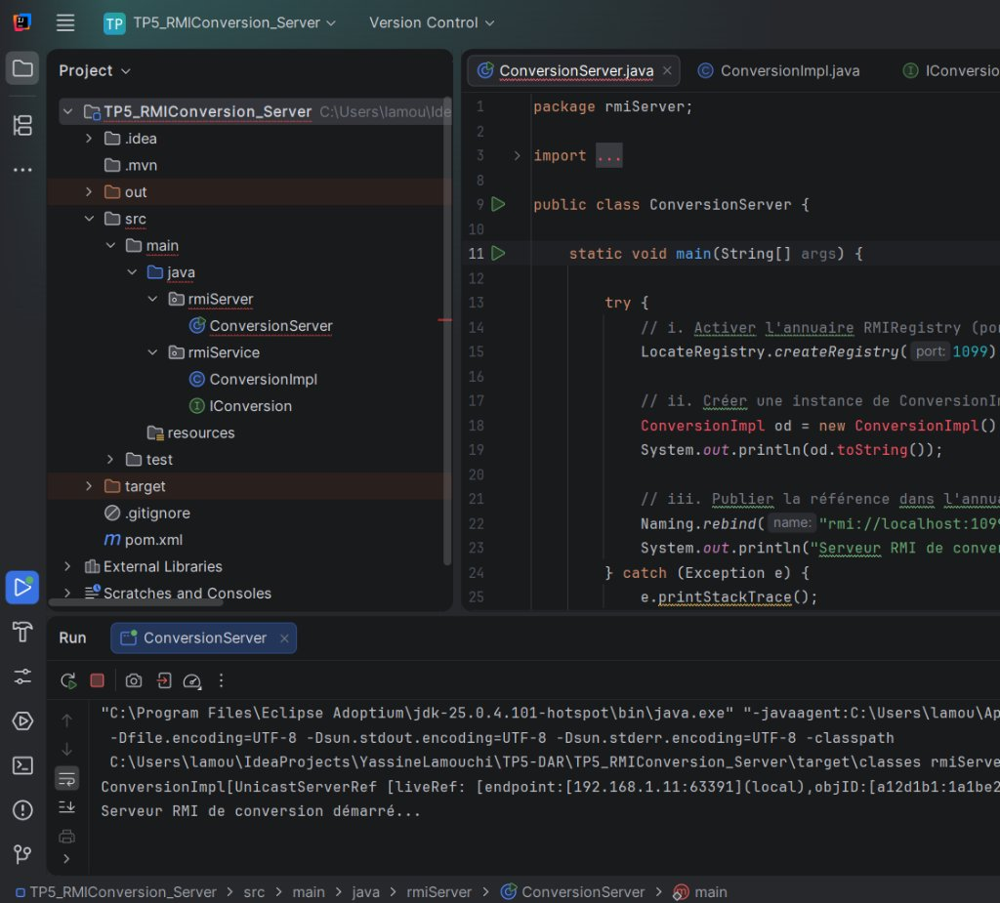
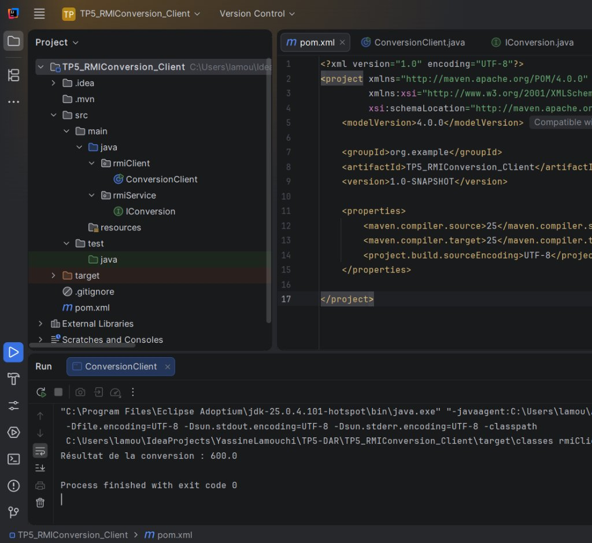
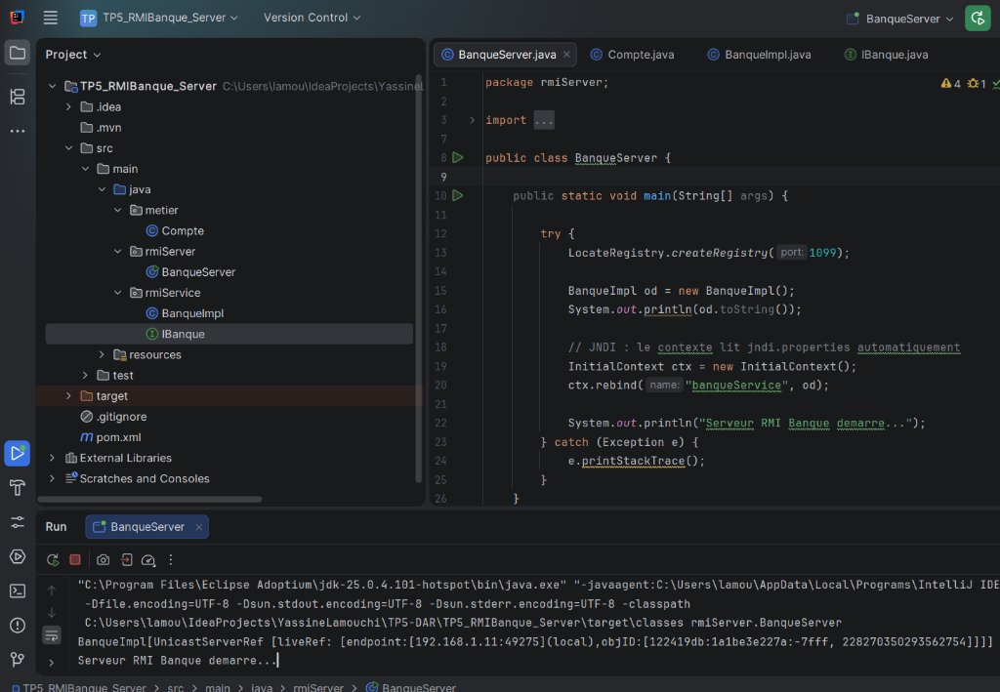
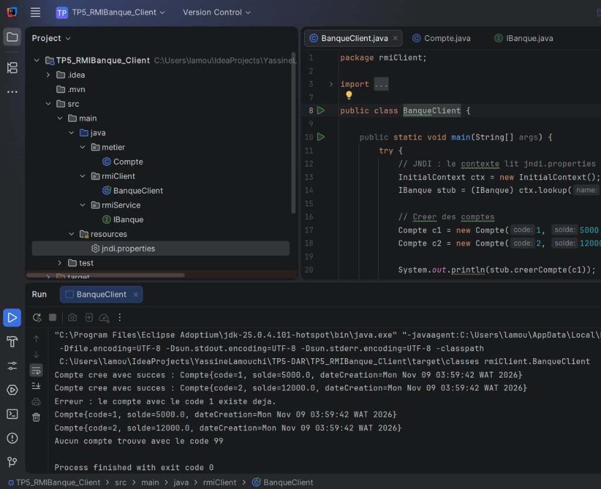

# TP5 - Développement d'Applications Réparties (Java RMI)

**Étudiant :** Yassine Lamouchi  
**Groupe :** LSI3 2.1  
**Matière :** Développement d'Applications Réparties  
**Année Universitaire :** 2026 – 2027

---

## Description générale

Ce dépôt contient les deux activités du TP5 portant sur l'**invocation de méthodes distantes avec Java RMI**.  
Le principe de RMI est de permettre à un objet Java s'exécutant dans une JVM d'appeler les méthodes d'un objet situé dans une autre JVM, comme s'il s'agissait d'un objet local. Le programmeur n'écrit que le flux de traitement (la logique métier), et RMI se charge du protocole, des sockets et de la sérialisation.

Chaque activité est composée de **deux projets Maven** distincts : un **Serveur** qui crée et publie l'objet distant, et un **Client** qui le recherche et invoque ses méthodes.

---

## Activité 5-1 : Service de conversion de devise

Application RMI client/serveur qui convertit un montant en euros vers le dinar tunisien (taux simplifié : × 3).

- Le serveur publie un objet `ConversionImpl` dans le registre RMI via `Naming.rebind()`.
- Le client récupère la référence avec `Naming.lookup()` et appelle `convertirMontant()`.

### Exécution

**1. Lancement du serveur** — `ConversionServer.main()` :



**2. Lancement du client** — `ConversionClient.main()` :



> Le client invoque `convertirMontant(200)` et reçoit le résultat `600.0`.

---

## Activité 5-2 : Service de banque avec RMI et JNDI

Application RMI client/serveur pour la gestion de comptes bancaires. Un compte est défini par un **code** (`int`), un **solde** (`double`) et une **date de création** (`Date`).

Le serveur offre deux services distants :

- `creerCompte(Compte c)` — crée un compte si le code n'existe pas déjà.
- `getInfoCompte(int code)` — consulte un compte à partir de son code.

**Différence avec l'activité 5-1 :** ici on utilise **JNDI** (`InitialContext` + `jndi.properties`) au lieu de `Naming` pour l'enregistrement (`rebind`) et la recherche (`lookup`) des objets distants.

### Exécution

**1. Lancement du serveur** — `BanqueServer.main()` :



**2. Lancement du client** — `BanqueClient.main()` :



> Le client crée deux comptes, tente de recréer un compte existant (erreur), puis consulte les comptes par code.

---

## Distribution des fichiers

```
TP5-DAR/
│
├── TP5_RMIConversion_Server/          (Activité 5-1 - Serveur)
│   ├── pom.xml
│   └── src/main/java/
│       ├── rmiService/
│       │   ├── IConversion.java        ← Interface distante
│       │   └── ConversionImpl.java     ← Implémentation du service
│       └── rmiServer/
│           └── ConversionServer.java   ← Lancement du serveur RMI
│
├── TP5_RMIConversion_Client/          (Activité 5-1 - Client)
│   ├── pom.xml
│   └── src/main/java/
│       ├── rmiService/
│       │   └── IConversion.java        ← Interface distante (copie)
│       └── rmiClient/
│           └── ConversionClient.java   ← Client RMI
│
├── TP5_RMIBanque_Server/              (Activité 5-2 - Serveur)
│   ├── pom.xml
│   └── src/main/
│       ├── java/
│       │   ├── metier/
│       │   │   └── Compte.java         ← Classe Serializable
│       │   ├── rmiService/
│       │   │   ├── IBanque.java        ← Interface distante
│       │   │   └── BanqueImpl.java     ← Implémentation du service
│       │   └── rmiServer/
│       │       └── BanqueServer.java   ← Lancement du serveur (JNDI)
│       └── resources/
│           └── jndi.properties         ← Configuration JNDI
│
├── TP5_RMIBanque_Client/              (Activité 5-2 - Client)
│   ├── pom.xml
│   └── src/main/
│       ├── java/
│       │   ├── metier/
│       │   │   └── Compte.java         ← Classe Serializable (copie)
│       │   ├── rmiService/
│       │   │   └── IBanque.java        ← Interface distante (copie)
│       │   └── rmiClient/
│       │       └── BanqueClient.java   ← Client RMI (JNDI)
│       └── resources/
│           └── jndi.properties         ← Configuration JNDI
│
├── screenshots/                       ← Captures d'écran d'exécution
│   ├── act1_server.jpg
│   ├── act1_client.jpg
│   ├── act2_server.jpg
│   └── act2_client.jpg
│
└── README.md
```

---

## Comment exécuter

### Prérequis

- JDK >= 1.8
- IntelliJ IDEA

### Activité 5-1

1. Ouvrir **TP5_RMIConversion_Server** dans IntelliJ → Exécuter `ConversionServer`
2. Ouvrir **TP5_RMIConversion_Client** dans IntelliJ → Exécuter `ConversionClient`

### Activité 5-2

1. Ouvrir **TP5_RMIBanque_Server** dans IntelliJ → Exécuter `BanqueServer`
2. Ouvrir **TP5_RMIBanque_Client** dans IntelliJ → Exécuter `BanqueClient`

> **Important :** toujours lancer le serveur **avant** le client.

---

## Technologies utilisées

- **Java RMI** — invocation de méthodes distantes
- **JNDI** — service d'annuaire pour l'enregistrement et la recherche d'objets distants
- **Maven** — gestion de projet
